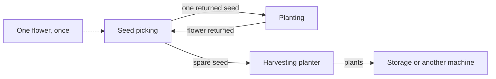

# Diagnosing the failures in output.txt

The original run created six blueprints and skipped eight **before placement or routing began**. The imported prices and recipes were present. The recipe analysis and stream builder could only handle a narrow class of dependency trees.

| Products skipped in the original output | First reported cause | What the complete chain needs |
|---|---|---|
| Buck Capsule A, Canned Citrome A | Multi-input topology unsupported | Grinding with two ingredients, plus plant/seed recycling |
| Buck Capsule B/C, Canned Citrome B/C | Recipe cycle | Productive crop/seed feedback with a net plant output |
| HC Valley Battery, Steel Part | Multi-input topology unsupported | Dense Ferrium Powder production, including Sandleaf recycling |

The old `OPTIMAL` result only optimized the six blueprints that survived this filtering. It did not establish that the other eight products were impossible or unprofitable.

## Productive recycling is different from an impossible cycle

A planting recipe consumes a seed and produces a flower. Seed picking consumes a flower and produces two seeds. The fixed plant template uses one seed picker and two planters:



Initialize one flower directly in each seed-picking unit, once. Its paired planter receives only its returned seed, and sends its flower only back to that picker. No recurring flower/seed imports or depot frontage are needed. A second planter converts the spare seeds to plants for downstream machines or a protocol stash. Electrical power is still required.

With one flower circulating and spare seeds exported immediately, the conservative cycle is picking time plus planting time: two seconds plus two seconds gives one spare seed every four seconds. Higher utilization would require extra circulating stock or a startup-priority mechanism, neither of which is assumed here. The plant module therefore exports 15 plants/minute with the recorded two-second recipes. Crop-dependent factory candidates are scaled to one module per crop; the regional optimizer can replicate factories to meet higher demand.

Generate the small depot-free module with:

```sh
./build/bin/aic_planner --list-seed-loops data/valley_iv
./build/bin/aic_planner --plant-loop sandleaf data/valley_iv
# Seed-only output remains available:
./build/bin/aic_planner --seed-loop sandleaf_seed data/valley_iv
```

The plant blueprint is the user's fixed 15×9 arrangement: planter, picker, planter across the top; stash and 2×2 electric pylon below. Its eight belt cells include a leftward export turn above the pylon. All four Valley IV plants share the same geometry and recipe-derived items. In larger factories, preserve the three internal connections, pylon position, and module envelope; route harvested plants directly downstream instead of adding another stash. The pylon still needs connection to the power network; electrical wire routing is not simulated.

The revised material-balance model allows productive loops, while rejecting loops whose input/output balance cannot provide net target output. It handles multi-ingredient recipes at every stage. Facility counts come from the balanced operation rates and actual recipe cycle times; some installed machines run below full utilization. Blueprint legends include their recipe IDs and utilization.

## Physical connections matter too

The stream allocator now balances every individual machine's inputs and outputs, assigns distinct ports, and permits parallel belts between the same two machines. A one-item/second flow requires two 0.5-item/second belts. Each belt consumes one output port and one input port; it cannot silently reuse a port or exceed capacity.

Recycling layouts use consistent machine orientation and additional clear routing lanes. A spacious dependency-based placement hint helps CP-SAT find a usable arrangement. Incoming and outgoing port order are matched to avoid needless crossings. These are layout heuristics, not a proof of the smallest possible factory.

## Commands

Rebuild in the Nix development shell:

```sh
build
./build/bin/aic_planner --validate data/valley_iv
./build/bin/aic_planner --blueprints-only --no-layouts data/valley_iv
./build/bin/aic_planner --no-layouts data/valley_iv
```

Inspect one blueprint with its recipe and recycling details:

```sh
./build/bin/aic_planner --product buck_capsule_a --blueprints-only data/valley_iv
```

Add `--log-level debug` to see machine counts, operation rates, placement retries, and routing conflicts. `--product` restricts the candidate portfolio; combine it with `--blueprints-only` when inspecting a product that needs batteries from another factory.

`--validate` checks production balances; it does not place facilities or route belts. `--blueprints-only` verifies those physical stages and returns failure if any requested blueprint is missing. The normal command then optimizes regional production across the successfully generated blueprints. The end-of-generation summary reports the count explicitly.

Pipe, environmental, and multiple-output mechanics remain outside this solid-item implementation. Finite placement/routing searches can also time out; a timeout is not evidence that an in-game factory is impossible.

Regional optimization defaults to 30 seconds once blueprints are generated. If the result is `FEASIBLE`, it has not proved the best possible regional portfolio. Increase the regional budget with `--solve-seconds 120` when needed.
